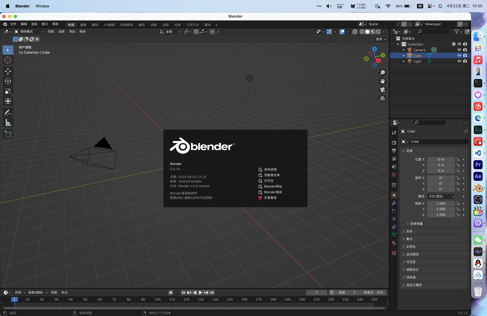
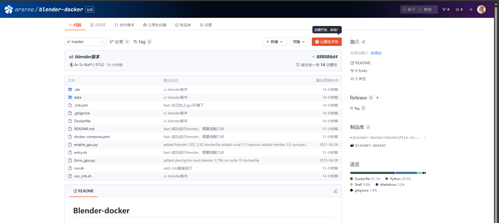

# Blender-docker

本镜像参考blender官方环境安装，

# 接入ArRM集群渲染使用（推荐）

## 下载控制端（已默认下载）

请前往 [https://www.arsrna.cn/app/render/](https://www.arsrna.cn/app/render/)，根据系统类型下载对应控制端

目前本项目已经配置有了

- 集群渲染控制端 `./arrm/arrm_control`，并已完成配置
- 集群渲染从机端 `arrm_server`

可以直接从cnb同时启动实现webui控制渲染的效果

## 启动

```bash
cd arrm
# 启动控制端
./arrm_control
# 启动从机端
./arrm_server
```


没写完，等会

# 在云原生开发中使用

首先Fork本仓库，适配自己的开发环境。

## 修改镜像适配blender
在`.ide/Dockerfile`修改`BLENDER_MAJOR`与`BLENDER_VERSION`，以便适配本地版本

本地版本可在blender内通过左上角`blender图标——关于`找到


## 启动

点击右上角云原生开发，直接启动


## 使用脚本启动
在打开的code-server内，启动Terminal，默认已经进入到了`/bin/bash`

*注：由于blender官方python文档写得太烂，建议因blender脚本遇到问题时，前往[stackexchange](https://blender.stackexchange.com/)查找和交流*

- 将需要处理的`.blend`文件上传到工作区
- 修改`eevee_render.py`，请参考下一章节[渲染脚本设置](#渲染脚本设置)
````shell
# 使用eevee渲染
/usr/local/blender/blender -b /workspace/{.blend文件} -P /workspace/eevee_render.py
# 使用cycles渲染
/usr/local/blender/blender -b /workspace/{.blend文件} -P /workspace/cycles_render.py
````

# 渲染脚本设置

要注意，由于我使用了mmd插件，导致摄像机视角有问题，透视变成了正交，所以加入了一句**强行让视角转为透视**，如果没有出现问题，或者摄像机本身就是正交视角的，请注释这一部分。

````python
for obj in bpy.data.objects:
    # 检查对象是否为摄像机
    if obj.type == 'CAMERA':
        # 设置摄像机为透视视角
        obj.data.type = 'PERSP'
        print(f"摄像机 {obj.name} 已设置为透视视角。")
````

更多配置请参考`eevee_render.py`内的注释进行修改

# TODO
- [ ] 加入VNC功能，方便图形化修改
- [√] 嵌入[ArRM](https://www.arsrna.cn/app/render/)，方便集群调用、管理渲染任务
- [ ] **大家大胆想，有建议或者想实现的可以提issue**

# 已知问题
- [√] 使用mmd插件进行制作的摄像机，会自动变为正交视角，导致渲染结果不一致