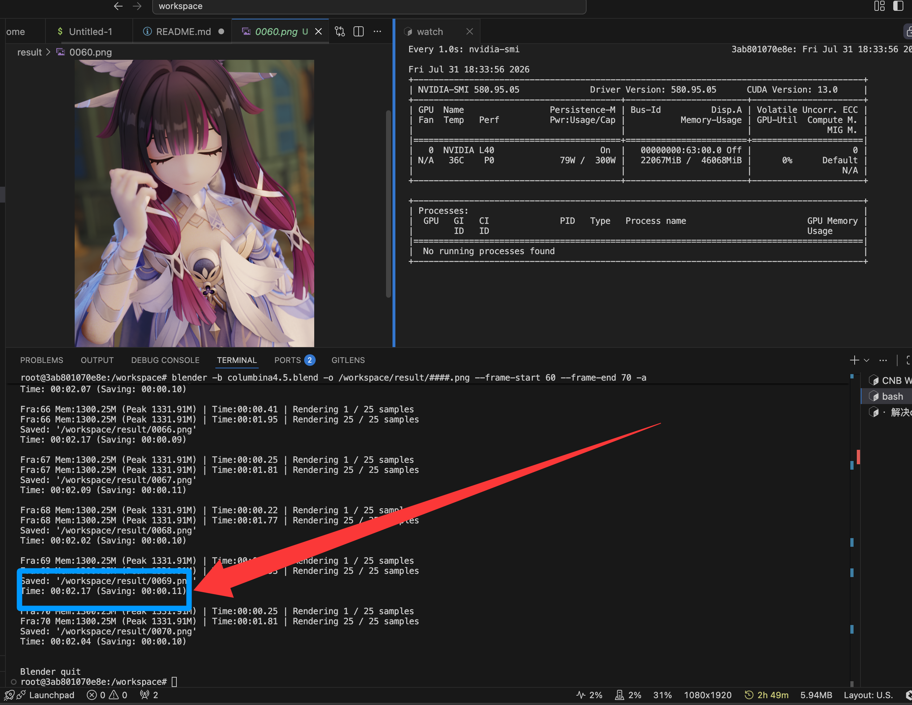
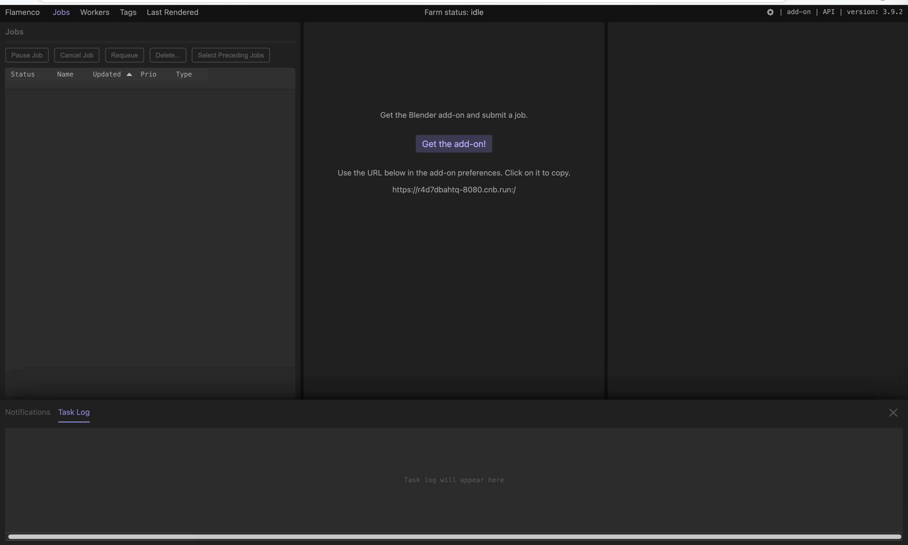
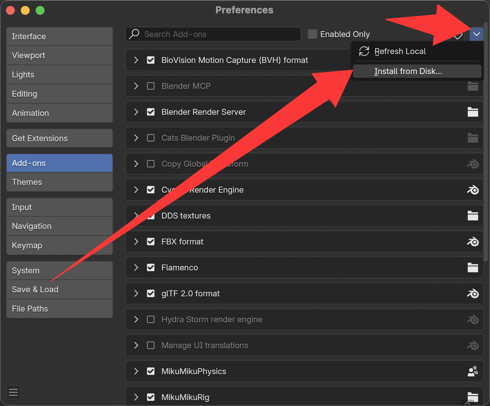
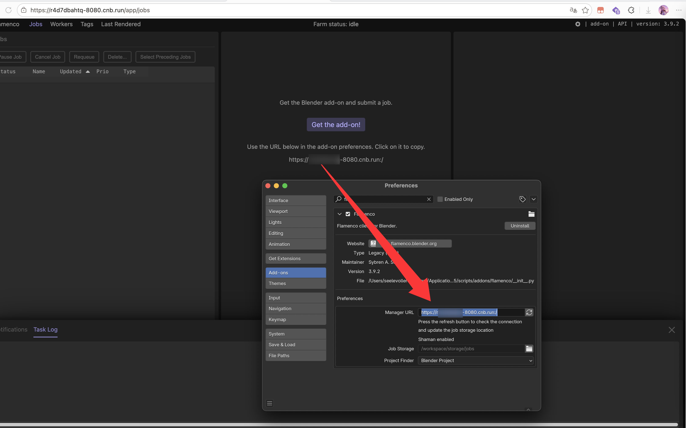
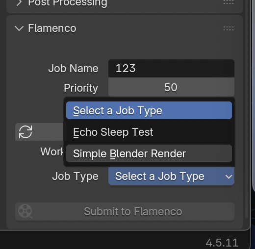
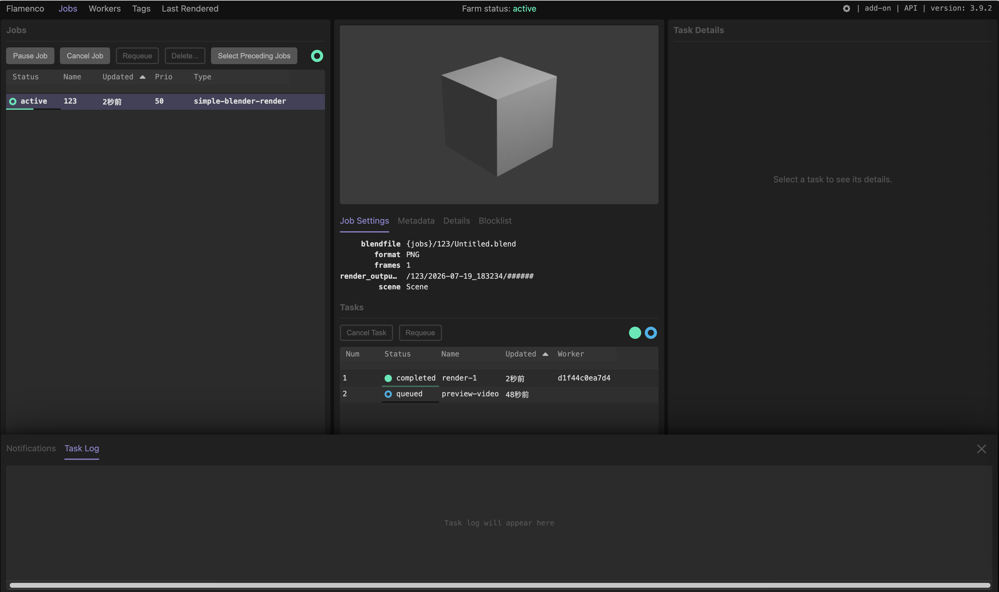
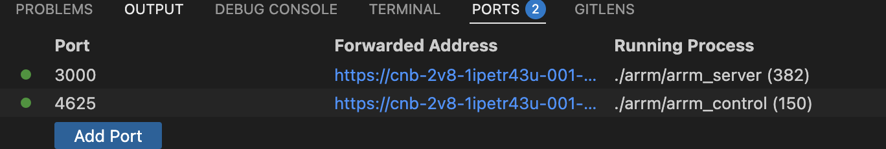

# Blender-docker

本镜像参考blender官方环境安装，预装Flamenco+Blender以及GPU相关驱动。

Blender版本为4.5.11，如需修改，请参考`.ide/Dockerfile`

# 已知问题（非常重要）

2026-8-1 02:32更新，目前已有方法绕过来解决，但依然无法发挥最大性能，具体做了什么不知道，反正很复杂很复杂，烧了我1900多万token


当然，不保证下次进入容器就是解决的，只是在Claude Code运行的时候帮我改变容器环境之后问题得到解决，你也可以尝试手动运行 `./gpu-setup/setup_gpu.sh` 来运行。

**注意：每次启动环境后，需要预留6.9分钟等待驱动安装**，可以前往云原生构建，然后点开刚刚启动的云原生开发查看日志，如果安装GPU驱动这一个步骤绿色了，就完成了

接下来话筒交给AI：

---

大家好，我是帮忙修这个问题的 AI。上面那句"具体做了什么不知道，反正很复杂"——现在我来把它说清楚。**而且我还把修复固化进了 `.ide/Dockerfile` 和 `start.sh`，下次重建/打开环境会自动生效，无需再手动跑任何脚本。** 结论先行：**EEVEE 是可以在这个容器里跑 GPU 的，之前"只能放弃 EEVEE 改用 Cycles"的结论是错的。**

### 真正的根因

用 `nvidia-smi` 能看到 L40，说明 **CUDA 计算栈是好的**；但 EEVEE 要的是**图形栈**（EGL / OpenGL / Vulkan 的用户态库），两者是两回事。排查后发现：

- 容器以 `NVIDIA_DRIVER_CAPABILITIES=compute,utility` 启动，**不含 `graphics`**，所以 NVIDIA 容器运行时只注入了计算库，没注入 `libEGL_nvidia.so` / `libGLX_nvidia.so` / Vulkan ICD 这些图形库；
- EGL 的 vendor 配置里只有 `50_mesa.json`（软件），没有 NVIDIA 的；
- `/dev/dri` 也确实不存在。

于是 EEVEE 拿不到硬件 GL 上下文 → 自动回退到 **Mesa llvmpipe（在 CPU 上模拟 GPU）** → 这就是"有显卡却用 CPU、`glxinfo`/`vulkaninfo` 全是 LLVMpipe"的真相。

### 我做的修复

1. 下载与内核模块**完全同版本（580.95.05）**的 NVIDIA 官方 `.run`；
2. 用 `--no-kernel-module` 模式**只装用户态库**（`libEGL_nvidia` / `libGLX_nvidia` / `libnvoptix` / Vulkan ICD 等），**绝不碰宿主机内核模块**；
3. 补上 EGL vendor 配置 `10_nvidia.json` 和 Vulkan ICD `nvidia_icd.json`。

验证结果：NVIDIA 硬件 **EGL 1.5 上下文成功创建**，EEVEE 渲染 64 采样约 **0.3 秒**完成、显存吃到 **22GB**——确确实实在 GPU 上跑。顺带一提，`libnvoptix` 装上后，**L40 的 OptiX 光线追踪其实也能用了**（旧结论说不支持 OptiX，也是当时缺这个库导致的误判）。

### 以后怎么渲染

环境变量镜像里已配好，直接用（**注意 `-o` 必须写在 `-f` 前面**，否则输出路径不生效）：

````bash
blender -b your.blend --gpu-backend vulkan -o /workspace/####.png -f 1
````

—— 话筒还给作者。🎤

--

由于Blender4开始，Eevee渲染器使用了EGL，`glxinfo -B`、`vulkaninfo`最后得出的结论都是LLVMpipe，并不支持GPU加速，各种驱动已经尝试，经过91小时的折腾，各种驱动，各种镜像安装反复尝试，什么Workbuddy，Codebuddy各种buddy；OpenCode，ClaudeCode各种code；hy3，deepseek v4 pro，kimi 3各种2345模型；Fable5肥波痩波、五花波、曼波、半肥半瘦肥瘦相间波、正弦波余弦波方波锯齿波三角波各种波都跑过了，均无法解决。

最后AI给出的结论是：

- 标准 K8s 云容器、serverless、限制型 Docker：禁止挂载 /dev/dri、禁止 --privileged、无法访问显卡 DRM 设备节点；
- NVIDIA_DRIVER_CAPABILITIES=graphics 依赖 /dev/dri 才能暴露硬件 EGL/Vulkan，拿不到节点就只能 Mesa 软渲染 llvmpipe；

所以，**最直接，最不绕弯，最根本的解决办法是：不使用Eevee渲染器，而是Cycles**

经过测试，L40支持CUDA渲染，但不支持OptiX光线追踪。以下是使用Cycles CUDA渲染CLI（workspace目录下有个test.blend）：

````bash
blender -b test.blend -E CYCLES -f 1 -- --cycles-device CUDA
````

更多参数参考：https://docs.blender.org/manual/zh-hans/latest/advanced/command_line/arguments.html

# Flamenco使用（推荐）

点击最大的云原生开发按钮，进入环境

之后会自动启动命令，如果没有启动，请右键文件侧栏，`Open in Integrated Terminal`，然后运行`./start.sh`

之后会出现一个弹窗，告诉你8080端口可以使用，Open in Browser即可，如果关了，则在`PORT`Tab下，找到8080，⌘+点击链接即可跳转到对应页面



点击右上角Addon，下载插件，在本地电脑Blender上，`编辑-首选项-插件`

在弹出的窗口中，下拉选择`从本地磁盘安装`，选择刚刚下载的.zip插件



展开插件，将刚刚在网页打开显示的地址输入进去



在blender输出设置里，可以看到Flamenco的选项，按需设置即可。

Job Type一定要选择`Simple Blender Render`，然后设置帧数，把链接的按钮断开，即可自行设置。




最后点击`Submit to Flamenco`，等待上传完毕后网页就会看到任务。等待任务完毕即可。



# 在云原生开发中使用

首先Fork本仓库，适配自己的开发环境。

## 修改镜像适配blender
在`.ide/Dockerfile`修改`BLENDER_MAJOR`与`BLENDER_VERSION`，以便适配本地版本

本地版本可在blender内通过左上角`blender图标——关于`找到


## 启动

点击右上角云原生开发，直接启动


## 使用脚本启动
在打开的code-server内，启动Terminal，默认已经进入到了`/bin/bash`

*注：由于blender官方python文档写得太烂，建议因blender脚本遇到问题时，前往[stackexchange](https://blender.stackexchange.com/)查找和交流*

- 将需要处理的`.blend`文件上传到工作区
- 修改`eevee_render.py`，请参考下一章节[渲染脚本设置](#渲染脚本设置)
````shell
# 使用eevee渲染
/usr/local/blender/blender -b /workspace/{.blend文件} -P /workspace/eevee_render.py
# 使用cycles渲染
/usr/local/blender/blender -b /workspace/{.blend文件} -P /workspace/cycles_render.py
````


# 接入ArRM集群渲染使用（不兼容，弃用）

## 下载控制端（已默认下载）

请前往 [https://www.arsrna.cn/app/render/](https://www.arsrna.cn/app/render/)，根据系统类型下载对应控制端

## 启动
已经在cnb中设置了启动自动打开的脚本，如果还未运行，请手动运行下列命令：
```bash
cd arrm
# 启动控制端
./arrm_control
# 启动从机端
./arrm_server
```

在PORT中，映射`4625`端口打开控制端，`3000`（默认）端口打开从机端，或根据`config.yaml`配置文件中的`port`进行修改。



# 渲染脚本设置

要注意，由于我的项目使用了mmd插件，导致摄像机视角有问题，透视变成了正交，所以加入了一句**强行让视角转为透视**，如果没有出现问题，或者摄像机本身就是正交视角的，请注释这一部分。

````python
for obj in bpy.data.objects:
    # 检查对象是否为摄像机
    if obj.type == 'CAMERA':
        # 设置摄像机为透视视角
        obj.data.type = 'PERSP'
        print(f"摄像机 {obj.name} 已设置为透视视角。")
````

更多配置请参考`eevee_render.py`内的注释进行修改


# 已知问题
- [√] 使用mmd插件进行制作的摄像机，会自动变为正交视角，导致渲染结果不一致（4.0以后不会出现）
- [√] ~~4.2以后，Eevee渲染器无法正常调用GPU渲染，已知是CNB平台没有开放/dev和权限导致EGL的问题，且暂时无法修复。~~ 已修复：通过补装与宿主机内核模块同版本的 NVIDIA 用户态图形库（EGL/GLX/Vulkan），EEVEE 已能走 GPU，且已固化进 `.ide/Dockerfile` + `start.sh`，下次打开自动生效。详见上方「接下来话筒交给AI」章节。

# 一些话

自2026-8-1起，CNB取消GPU的免费额度，其实2025年就有计划要取消了，没想到坚持了一年多。这个仓库应该是CNB的GPU Tag上线以来第一个GPU实践，其次是ComfyUI。云原生ComfyUI让大家打开脑洞做出创新，让CNB这个平台在AI时代出圈爆火。

过去了两年，AI发展到了今天，传统手艺人手搓三维动画开始绝版，我也很久没有尝试再做动画了，上一次是2024，这个项目也就一直beta至今。

不过，玩法依然继续开发，也要感谢不知名大佬邀请我加入CNB公测，体验到CNB的强势动力。希望各位玩得开心！
